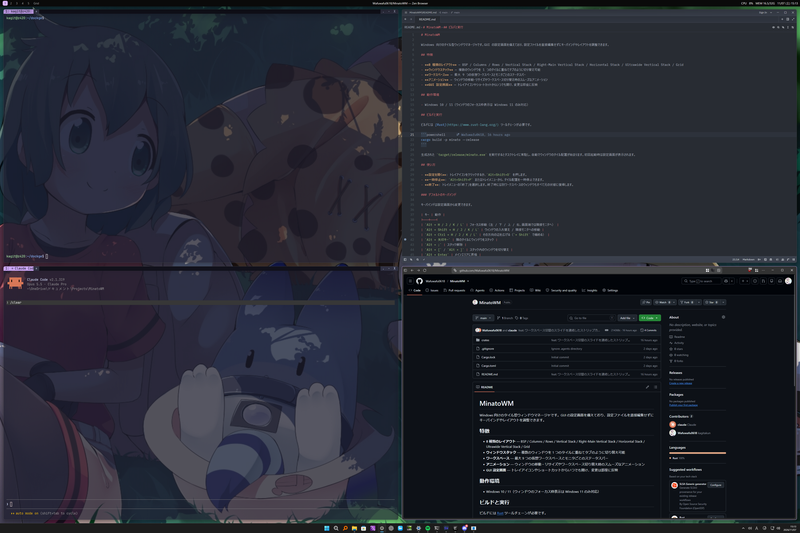

# MinatoWM

[English](README.md) | 日本語



Windows 向けのタイル型ウィンドウマネージャです。GUI の設定画面を備えており、設定ファイルを直接編集せずにキーバインドやレイアウトを調整できます。

## 特徴

- **8 種類のレイアウト** — BSP / Columns / Rows / Vertical Stack / Right-Main Vertical Stack / Horizontal Stack / Ultrawide Vertical Stack / Grid
- **ウィンドウスタック** — 複数のウィンドウを 1 つのタイルに重ねてタブのように切り替え可能
- **ワークスペース** — 最大 9 つの仮想ワークスペースとモニタごとのステータスバー
- **アニメーション** — ウィンドウの移動・リサイズやワークスペース切り替え時のスムーズなアニメーション
- **GUI 設定画面** — トレイアイコンやショートカットからいつでも開け、変更は即座に反映

## 動作環境

- Windows 10 / 11（ウィンドウのフォーカス枠表示は Windows 11 のみ対応）

## ビルドと実行

ビルドには [Rust](https://www.rust-lang.org/) ツールチェーンが必要です。

```powershell
cargo build -p minato --release
```

生成された `target/release/minato.exe` を実行するとタスクトレイに常駐し、自動でウィンドウのタイル配置が始まります。初回起動時は設定画面が表示されます。

## 使い方

- **設定を開く**: トレイアイコンをクリックするか、`Alt+Shift+O` を押します。
- **一時停止**: `Alt+Shift+P` またはトレイメニューから、タイル配置を一時停止できます。
- **終了**: トレイメニューの「終了」を選択します。終了時には別ワークスペースのウィンドウもすべて元の状態に復帰します。

### デフォルトのキーバインド

キーバインドは設定画面から変更できます。

| キー | 動作 |
|---|---|
| `Alt + H / J / K / L` | フォーカス移動（左 / 下 / 上 / 右、画面端では隣接モニタへ） |
| `Alt + Shift + H / J / K / L` | ウィンドウの入れ替え / 隣接モニタへの移動 |
| `Alt + Ctrl + H / J / K / L` | その方向の辺を広げる（`+ Shift` で縮める） |
| `Alt + 矢印キー` | 隣のタイルにウィンドウをスタック |
| `Alt + ;` | スタック解除 |
| `Alt + [` / `Alt + ]` | スタック内のウィンドウを切り替え |
| `Alt + Enter` | メインエリアに昇格 |
| `Alt + Space` | レイアウトを切り替え |
| `Alt + X` / `Alt + Y` | レイアウトの左右反転 / 上下反転 |
| `Alt + T` | フローティング表示の切り替え |
| `Alt + F` | モノクル（最大化）表示の切り替え |
| `Alt + 1..9` | ワークスペースを切り替え |
| `Alt + Shift + 1..9` | ウィンドウを指定ワークスペースへ移動 |
| `Alt + Q` | ウィンドウを閉じる |
| `Alt + Shift + R` | 再タイル |
| `Alt + Shift + O` | 設定画面を開く |
| `Alt + Shift + P` | 一時停止 / 再開 |

## ライセンス

[MIT License](LICENSE)
