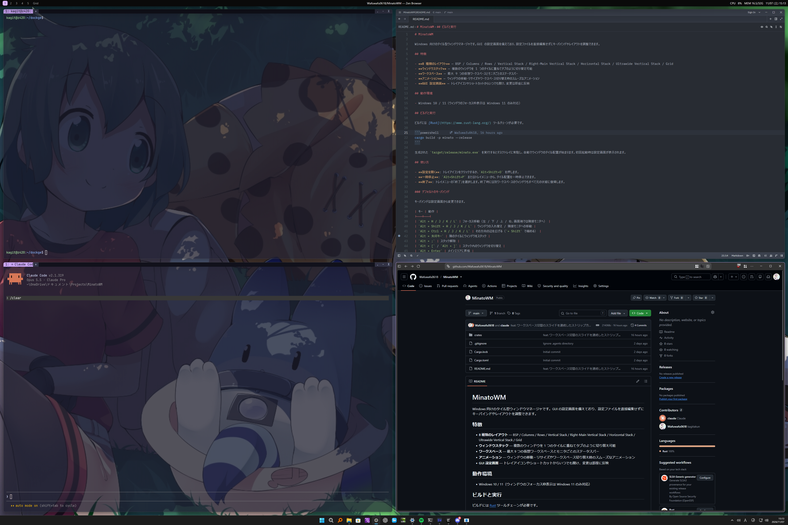

# MinatoWM

English | [日本語](README.ja.md)



A tiling window manager for Windows. It comes with a GUI settings window, so you can adjust keybindings and layouts without editing configuration files by hand.

## Features

- **8 layouts** — BSP / Columns / Rows / Vertical Stack / Right-Main Vertical Stack / Horizontal Stack / Ultrawide Vertical Stack / Grid
- **Window stacks** — Stack multiple windows in a single tile and switch between them like tabs
- **Workspaces** — Up to 9 virtual workspaces, with a status bar on each monitor
- **Animations** — Smooth animations for moving and resizing windows and for switching workspaces
- **GUI settings** — Open it anytime from the tray icon or a shortcut; changes take effect immediately

## Requirements

- Windows 10 / 11 (the window focus border is only available on Windows 11)

> **Note:** The user interface (settings window and tray menu) is currently available in Japanese only.

## Build and Run

Building requires the [Rust](https://www.rust-lang.org/) toolchain.

```powershell
cargo build -p minato --release
```

Run the generated `target/release/minato.exe`. It stays in the system tray and starts tiling windows automatically. The settings window opens on first launch.

## Usage

- **Open settings**: Click the tray icon or press `Alt+Shift+O`.
- **Pause**: Pause tiling with `Alt+Shift+P` or from the tray menu.
- **Quit**: Select "終了" (Quit) from the tray menu. On exit, all windows, including those on other workspaces, are restored to their original state.

### Default Keybindings

Keybindings can be changed in the settings window.

| Key | Action |
|---|---|
| `Alt + H / J / K / L` | Move focus (left / down / up / right; moves to the adjacent monitor at the screen edge) |
| `Alt + Shift + H / J / K / L` | Swap windows / move to the adjacent monitor |
| `Alt + Ctrl + H / J / K / L` | Grow the edge in that direction (`+ Shift` to shrink) |
| `Alt + Arrow keys` | Stack the window onto the neighboring tile |
| `Alt + ;` | Unstack |
| `Alt + [` / `Alt + ]` | Cycle through windows in the stack |
| `Alt + Enter` | Promote to the main area |
| `Alt + Space` | Cycle layouts |
| `Alt + X` / `Alt + Y` | Flip the layout horizontally / vertically |
| `Alt + T` | Toggle floating |
| `Alt + F` | Toggle monocle (maximized) mode |
| `Alt + 1..9` | Switch workspace |
| `Alt + Shift + 1..9` | Move the window to the specified workspace |
| `Alt + Q` | Close the window |
| `Alt + Shift + R` | Retile |
| `Alt + Shift + O` | Open settings |
| `Alt + Shift + P` | Pause / resume |

## License

MIT License
